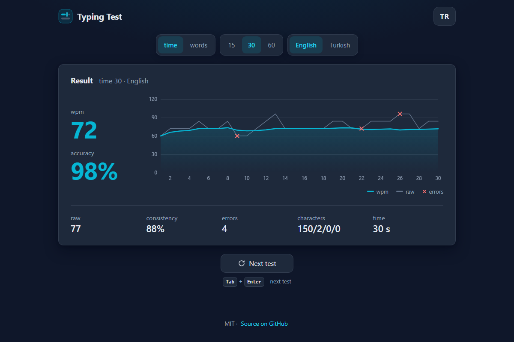

# Typing Test - a clean typing speed test with English and Turkish words, right in the browser

[](#tests)
[](LICENSE)

**▶ Open the app: https://celaldrg.github.io/typing-test/**



## Features

- Two modes: **time** (15, 30 or 60 seconds) and **words** (10, 25 or 50 words).
- English and Turkish word lists (250 common words each), chosen separately from the interface language.
- Exact letter comparison: `ı` and `i`, `İ` and `I` are different letters, nothing is lower-cased or folded.
- Every letter is coloured as you type: correct, incorrect or extra. Words left with a mistake are underlined.
- A smooth caret and a three-line view that scrolls with you.
- Live counter (seconds left or words done), live WPM and a progress bar. The clock starts with your first key.
- Results: WPM, raw WPM, accuracy, consistency, errors, characters (correct / incorrect / extra / missed), time, and a chart of WPM in every second with raw WPM and error marks.
- Best result for each mode, length and word list, kept in your browser.
- English and Turkish interface (TR / EN button); the choice is remembered.
- Works with phone keyboards, including suggestions and autocorrect. Paste is blocked.
- `?demo` shows the results of a finished 30-second test.
- Plain HTML, CSS and JavaScript modules: no dependencies, no build step, no external requests.

How the numbers are calculated:

- **WPM** = (letters of correctly typed words + the Space after each) / 5, per minute.
- **Raw** = every typed character, mistakes and deleted ones included, / 5, per minute.
- **Accuracy** = correct keystrokes / all keystrokes.
- **Consistency** = 100 × (1 − tanh(cv)), where cv is the coefficient of variation of the raw WPM of each second.

## How to use (keyboard + touch)

**Keyboard**

- Start typing: the clock starts with the first key.
- `Space` moves to the next word. `Backspace` corrects; it goes back into the previous word only when that word has a mistake.
- `Tab` then `Enter` restarts the test, or starts the next one from the results.
- `Tab` / `Shift+Tab` and `Enter` / `Space` reach every setting. Typing a letter brings the focus back to the words.

**Touch**

- Tap the words to open the on-screen keyboard and type.
- Tap the settings to change mode, length or word list, and **Restart** (or **Next test**) for a new test.
- **TR** / **EN** in the header switches the interface language.

## Run locally

```sh
npx serve .
```

Then open the address it prints. The page uses ES modules, which browsers load only over `http://`, so opening `index.html` straight from the disk does not work. Any static server will do.

## Tests

```sh
node --test
```

Needs Node.js 22 or newer and nothing else; there is nothing to install. The suites cover the WPM, accuracy and consistency formulas, the exact Turkish letter comparison, the test rules (Space, Backspace, extra letters, the end of time and words tests, the per-second history), the seeded word sequence, the word lists, settings, storage and best results, the demo, the interface strings and number formats, the handling of text-field edits and the chart scale. GitHub Actions runs them on every push and pull request.

## Project structure

```text
index.html            page markup
style.css             dark theme, layout and phone rules
src/
  main.js             entry point: connects the test, settings and views to the page
  game.js             test rules, clock, per-second history and result
  typing.js           letter states and character counts
  metrics.js          WPM, accuracy and consistency
  rng.js              seeded random numbers
  generator.js        seeded word sequence
  wordlists.js        English and Turkish words
  settings.js         modes, lengths and word lists
  records.js          best results
  storage.js          the only access to localStorage
  demo.js             the finished test shown by ?demo
  i18n.js             English and Turkish interface strings, number formats
  field-edit.js       turns text-field changes into keystrokes
  typing-field.js     the hidden input that receives the typing
  words-view.js       words, letter colours, caret and scrolling
  results-view.js     results card
  chart.js            WPM chart on a canvas
  chart-scale.js      chart axis steps
  dom.js              small DOM helpers
test/                 node:test suites
docs/screenshot.png   the ?demo view
```

## License

[MIT](LICENSE) © 2026 Celalettin Durgaç

## Türkçe

Tarayıcıda çalışan, İngilizce ve Türkçe kelimelerle yazma hızı testi.

**▶ Uygulamayı aç: https://celaldrg.github.io/typing-test/**

### Özellikler

- İki tür: **süre** (15, 30 ya da 60 saniye) ve **kelime** (10, 25 ya da 50 kelime).
- İngilizce ve Türkçe kelime listeleri (her biri 250 yaygın kelime); arayüz dilinden ayrı seçilir.
- Harfler birebir karşılaştırılır: `ı` ile `i`, `İ` ile `I` farklı harflerdir; hiçbir harf küçültülmez ya da dönüştürülmez.
- Her harf yazarken renklenir: doğru, yanlış ya da fazla. Hatayla geçilen kelimelerin altı çizilir.
- Yumuşak kayan imleç ve yazdıkça kayan üç satırlık görünüm.
- Canlı sayaç (kalan saniye ya da yazılan kelime), canlı hız ve ilerleme çubuğu. Sayaç ilk tuşla başlar.
- Sonuç: kelime/dk, ham hız, doğruluk, tutarlılık, hata, karakterler (doğru / yanlış / fazla / eksik), süre ve her saniyenin hızını, ham hızı ve hataları gösteren grafik.
- Her tür, uzunluk ve kelime listesi için en iyi sonuç tarayıcıda saklanır.
- İngilizce ve Türkçe arayüz (TR / EN düğmesi); seçim hatırlanır.
- Telefon klavyeleriyle, öneri ve otomatik düzeltmeyle de çalışır. Yapıştırma kapalıdır.
- `?demo` bitmiş bir 30 saniyelik testin sonucunu gösterir.
- Yalın HTML, CSS ve JavaScript modülleri: bağımlılık, derleme adımı ve dış istek yok.

Hesaplar:

- **Kelime/dk** = (doğru yazılan kelimelerin harfleri + her birinden sonraki boşluk) / 5, dakika başına.
- **Ham** = hatalı ve silinenler dahil yazılan her karakter / 5, dakika başına.
- **Doğruluk** = doğru tuş vuruşu / bütün tuş vuruşları.
- **Tutarlılık** = 100 × (1 − tanh(cv)); cv, her saniyedeki ham hızın değişim katsayısıdır.

### Nasıl kullanılır (klavye + dokunmatik)

**Klavye**

- Yazmaya başla: sayaç ilk tuşla başlar.
- `Boşluk` sonraki kelimeye geçer. `Geri silme` düzeltir; önceki kelimeye yalnız o kelimede hata varsa döner.
- `Tab` ardından `Enter` testi yeniden başlatır, sonuç ekranında sonraki testi açar.
- `Tab` / `Shift+Tab` ve `Enter` / `Boşluk` ile bütün ayarlara ulaşılır. Bir harf yazınca odak kelimelere döner.

**Dokunmatik**

- Ekran klavyesini açmak için kelimelere dokun ve yaz.
- Türü, uzunluğu ya da kelime listesini değiştirmek için ayarlara, yeni test için **Yeniden başlat** (ya da **Sonraki test**) düğmesine dokun.
- Başlıktaki **TR** / **EN** arayüz dilini değiştirir.

### Yerelde çalıştırma

```sh
npx serve .
```

Sonra yazdığı adresi aç. Sayfa ES modülleri kullanır; tarayıcılar bunları yalnız `http://` üzerinden yükler, bu yüzden `index.html` doğrudan diskten açılınca çalışmaz. Herhangi bir statik sunucu yeterli.

### Testler

```sh
node --test
```

Node.js 22 ya da daha yenisi yeter; kurulacak bir şey yok. Testler kelime/dk, doğruluk ve tutarlılık formüllerini, Türkçe harflerin birebir karşılaştırılmasını, test kurallarını (boşluk, geri silme, fazla harfler, süre ve kelime testlerinin bitişi, saniye saniye geçmiş), tohumlu kelime dizisini, kelime listelerini, ayarları, depolamayı ve en iyi sonuçları, demoyu, arayüz metinlerini ve sayı biçimlerini, metin kutusu değişikliklerinin işlenmesini ve grafik ölçeğini kapsar. GitHub Actions her push ve pull request'te çalıştırır.

### Lisans

[MIT](LICENSE) © 2026 Celalettin Durgaç
